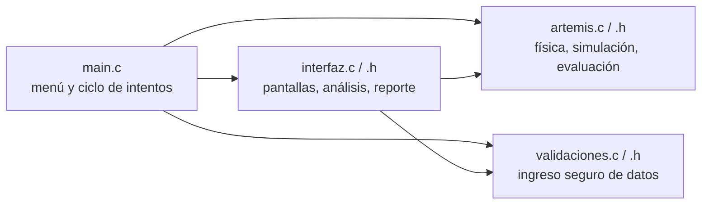

# Simulador Artemis – Situación 3: Inyección Translunar (TLI)

UTN FRRe · Algoritmos y Estructuras de Datos · Trabajo Final Integrador (Lenguaje C)

## a) Integrantes y comisión

| Apellido y nombre | Legajo | Usuario GitHub |
|-------------------|--------|----------------|
| Pablo Ignacio Gutierrez | 28135  |pabloignaciogutierrez28-sys|
| Radis Liana Guadalupe | 28366  |lianaradis4-strack|
| Chamborr Maximo| 27953 |                |
| _completar_       |        |                |

Comisión: _completar_

## b) Escenario y reglas del juego

Desde la órbita baja terrestre (LEO), la etapa ICPS ejecuta la Inyección Translunar y deja a Orion
con velocidad `v_TLI` (oficial: 10 900 m/s, m = 26 000 kg, h = 192 km). Luego los motores se apagan
y la nave sigue una trayectoria libre hacia la Luna (D = 384 000 km).

El programa responde las 4 consignas del enunciado:

- **a)** Primera Ley de Newton: simulación de vuelo libre (inercia + gravedad que frena la nave).
- **b)** Energía cinética inicial `Ki = ½ m v²`.
- **c)** Trabajo adicional mínimo por unidad de masa de LEO al punto de equilibrio gravitatorio Tierra‑Luna, por conservación de `Em = K + U`.
- **d)** Justificación energética de por qué ir a la Luna cuesta más combustible que volver.

**Reglas del juego.** El usuario elige `h`, `v_TLI` y la masa (o usa los valores oficiales). Cada intento
se evalúa con 3 criterios (33 puntos c/u, 100 máximo):

1. La energía aportada por la TLI alcanza el punto de equilibrio.
2. La simulación llega a la vecindad de la Luna.
3. `v_TLI` < velocidad de escape (trayectoria ligada, retorno libre posible).

Se guardan hasta 10 intentos para el reporte final (opción 4, exportable a `reporte_artemis.txt`).

> Con los valores oficiales (10 900 m/s) la nave **no** llega al punto de equilibrio: el programa calcula
> una velocidad mínima de ≈ 10 905 m/s. Con `v_TLI = 11 000 m/s` la misión se cumple.

## c) Funcionamiento



Flujo de un intento: `pedirParametros` → `tli_calcular` (incisos b, c, d) → `tli_simular` (inciso a) →
`tli_evaluar` → `mostrarAnalisis` / `mostrarSimulacion` / `mostrarEvaluacion` → se guarda en `historial[]`.

| Módulo | Responsabilidad |
|--------|-----------------|
| `main.c` | `main()`, menú principal y ciclo de intentos. Opción oculta `--test`. |
| `artemis.h / artemis.c` | Constantes, `struct`s, cálculos analíticos, simulación velocity‑Verlet (paso 30 s, 1D Tierra‑Luna), evaluación y autotest. |
| `interfaz.h / interfaz.c` | Menú, análisis incisos a‑d, telemetría, evaluación y reporte (`FILE *`). |
| `validaciones.h / .c` | `leerEntero`, `leerDouble`, `leerSiNo`: `fgets` + `strtol/strtod`, rango, coma decimal, EOF, líneas largas. |

Se usan arreglos (`muestras[]`, `historial[]`) y punteros (parámetros `const T *`, `Intento *`, `FILE *`).
Modelo simplificado: 1D sobre la línea Tierra‑Luna, Luna fija, sin resistencia.

## d) Compilación y ejecución

```bash
make          # compila (gcc, -std=c11 -Wall -Wextra -pedantic)
./artemis     # ejecuta el simulador
make test     # autotest numérico
make clean
```

Requiere `gcc` y `make` (Linux/macOS, o MinGW/WSL en Windows). En consolas de Windows ejecutar
`chcp 65001` antes para ver bien los acentos.

## e) Registro de uso de Inteligencia Artificial

| Herramienta | Tarea | Prompt / consulta realizada | Cómo se validó / adaptó |
|-------------|-------|-----------------------------|--------------------------|
| Claude (Sonnet 5.5) | Generación del código base modular de la Situación 3 (`main.c`, `artemis.*`, `interfaz.*`, `validaciones.*`, `Makefile`) | Se adjuntó el PDF del enunciado y se escribió: *"Lee el documento adjunto con atención y actúa como un experto programador en lenguaje C. Genera un programa en C completo, modular, optimizado y limpio (estándar C99/C11) que cumpla rigurosamente con todas las especificaciones, requisitos, entradas, salidas y restricciones descritas en el archivo. Por favor incluye: 1. El código fuente completo y listo para compilar. 2. Comentarios explicativos en la lógica principal y funciones clave. 3. Manejo adecuado de errores y liberación de memoria si aplica. 4. Una función main() de prueba para verificar su funcionamiento."* | Compilación con `-Wall -Wextra -pedantic` sin warnings; `make test` (7 pruebas OK); sesiones de prueba con entradas inválidas (letras, vacío, fuera de rango, coma decimal, EOF). |
| Claude (Sonnet 5.5) | Acotar el proyecto a un solo escenario | *"haz la situacion 3"* | Se verificó que el código cubre los incisos a–d de la Situación 3. |
| Claude (Sonnet 5.5) | Completar el README (integrantes, tabla de IA, diagrama) | Pedidos puntuales para cargar los nombres de los integrantes y *"completa vos lo que puedas"* | Revisión manual del README. |

> **Pendiente del equipo:** agregar acá cualquier otra consulta que hagan a una IA (dudas de punteros, errores del compilador, etc.), y describir qué revisaron, probaron o modificaron ustedes en el código. Esta tabla debe reflejar solo lo que realmente ocurrió.

Todos los integrantes deben poder explicar cada línea del código en el coloquio.
